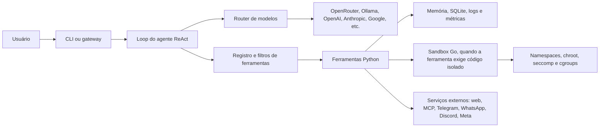

# Zeus — documentação do projeto

O Zeus é um harness de agente em Python: conecta um modelo de linguagem a um loop ReAct, ferramentas, memória e integrações. Para execução de código isolada, pode usar um serviço sandbox escrito em Go.

Esta página apresenta o projeto e seus principais fluxos. Os guias especializados estão em [Uso](USAGE.md), [Ferramentas](TOOLS.md), [Configuração](CONFIG.md), [Arquitetura](ARCHITECTURE.md), [Gateways](GATEWAY.md), [MCP](MCP.md) e [Sandbox](SANDBOX.md).

## O que o Zeus faz

- Recebe tarefas pela CLI local ou por gateways de mensagens.
- Consulta provedores LLM por uma interface comum.
- Permite que o agente escolha ferramentas registradas, valide argumentos e observe seus resultados.
- Mantém sessões, memória, perfil, aprendizados, métricas e logs.
- Oferece planejamento, equipes de agentes especializados e tarefas agendadas.
- Integra ferramentas externas por MCP.
- Separa comandos de host de execução Python/shell na sandbox Go.

O pacote Python declara versão `0.1.0` e requer Python `>=3.8`. O CI do repositório testa Python 3.10, 3.11 e 3.12, além de compilar/testar a sandbox com Go 1.22.

## Arquitetura em uma visão



### Componentes

| Componente | Responsabilidade |
|---|---|
| `zeus/cli/` | CLI interativa, comandos, sessão e confirmações locais. |
| `zeus/core/agent.py` | Loop do agente, contexto, seleção/execução de ferramentas e limite de turnos. |
| `zeus/core/router.py` | Adapta provedores de modelos a uma interface comum. |
| `zeus/core/registry.py` | Registra ferramentas com descrição, schema, handler, tags e variáveis necessárias. |
| `zeus/tools/` | Implementa ferramentas de shell, arquivos, web/browser, memória, Git, scheduler, configuração e código. |
| `zeus/security/` | Gerencia permissões, confirmações, guardrails, rate limits e auditoria. |
| `zeus/memory/`, `zeus/db/` | Memória, histórico, perfil, aprendizados e persistência SQLite/JSON. |
| `zeus/observability/` | Métricas, custo estimado, tracing e resumo de sessão. |
| `zeus/gateway/` | Adaptadores para Telegram, WhatsApp, Discord e Instagram Messaging. |
| `zeus/mcp/` | Cliente para servidores MCP e servidor MCP que exporta ferramentas do Zeus. |
| `sandbox/` | Serviço Go que valida requisições e executa payloads em isolamento Linux. |

### Fluxo de uma tarefa

1. A CLI ou um gateway recebe a mensagem e cria/recupera a sessão.
2. O agente reúne histórico e contexto relevante de memória, perfil e aprendizados.
3. O registro expõe ao modelo somente as ferramentas disponíveis e compatíveis com o filtro ativo.
4. O router chama o provedor configurado e normaliza a resposta.
5. Se houver chamadas de ferramenta, o Zeus valida schema, permissões e guardrails; ações que exigem consentimento podem solicitar confirmação.
6. O resultado retorna ao contexto do agente. O ciclo continua até a resposta final ou o limite de turnos.
7. Histórico, métricas e rastreamento são persistidos conforme a configuração.

## Provedores LLM

O router reconhece os seguintes identificadores:

| `ZEUS_PROVIDER` | Credencial/configuração principal |
|---|---|
| `openrouter` | `OPENROUTER_API_KEY` |
| `ollama` | Servidor local; `OLLAMA_HOST` é opcional. |
| `opencode_go` | `OPENCODE_GO_API_KEY`; `OPENCODE_GO_BASE_URL` pode sobrescrever o endpoint. |
| `openai` | `OPENAI_API_KEY` |
| `anthropic` | `ANTHROPIC_API_KEY` |
| `google` ou `google_api` | `GEMINI_API_KEY` ou `GOOGLE_API_KEY`. |
| `google_auth` | OAuth via navegador, iniciado com `/auth google`. |
| `deepseek` | `DEEPSEEK_API_KEY` |
| `mistral` | `MISTRAL_API_KEY` |
| `groq` | `GROQ_API_KEY`; endpoint OpenAI-compatible. |
| `xai` | `XAI_API_KEY`; endpoint OpenAI-compatible. |
| `together` | `TOGETHER_API_KEY`; endpoint OpenAI-compatible. |
| `fireworks` | `FIREWORKS_API_KEY`; endpoint OpenAI-compatible. |
| `cohere` | `COHERE_API_KEY`; API compatibility OpenAI. |

O modelo é selecionado por `ZEUS_MODEL`. Os valores padrão são `openrouter` e `openrouter/auto`; confirme disponibilidade e nomes de modelos junto ao provedor escolhido.

## Instalação e primeiro uso

### Requisitos

- Python 3.8 ou superior (a matriz de CI cobre 3.10–3.12).
- Go 1.20 ou superior para compilar a sandbox opcional.
- Node.js/npm apenas para a ponte WhatsApp Baileys.
- Para executar a sandbox: Linux amd64, root, cgroup v2 com controladores `cpu`, `memory` e `pids`, `cgroup.kill`, namespaces e seccomp-bpf disponíveis.

### Instalação recomendada

```bash
git clone https://github.com/vps28app-web/zeus-agent.git
cd zeus-agent
./scripts/install.sh
zeus setup
```

O instalador roda como usuário normal, cria `.venv`, instala os entry points Python, prepara `~/.zeus/.env` com permissões privadas e gera o token da sandbox. Não instala pacotes de sistema nem habilita serviços systemd automaticamente. O guia completo está em [INSTALACAO.md](INSTALACAO.md).

Para configurar o provedor depois da instalação, use `zeus setup`; na CLI interativa, `/models` troca provedor/modelo e `/config set NOME_DA_CHAVE` abre entrada mascarada para credenciais.

### Sandbox opcional

O instalador compila a sandbox quando Go está disponível em Linux amd64. Para compilar manualmente:

```bash
cd sandbox
go build -o sandbox ./cmd/sandbox
```

A implantação do serviço privilegiado é uma etapa separada. Consulte [SANDBOX.md](SANDBOX.md) antes de iniciar manualmente ou instalar as units systemd.

## Persistência e diretórios

`ZEUS_HOME` define o diretório de estado e, por padrão, vale `~/.zeus`.

- `~/.zeus/.env`: configuração global de ambiente e credenciais.
- `.env` no diretório do projeto: configuração local adicional.
- `~/.zeus/config.yaml`: valores não secretos, como modelo, provedor e `max_turns`.
- `~/.zeus/zeus.db`: sessões, turnos, memória, métricas, tarefas, perfis e auditoria quando SQLite está habilitado.
- `~/.zeus/memory.json`: backend JSON alternativo de memória.
- `~/.zeus/logs/<session_id>.jsonl`: cópia legível do histórico de cada sessão.
- `.zeus_history` no diretório atual: histórico da CLI interativa.
- `~/.zeus/mcp_servers.json`: configuração persistente de servidores MCP.

O SQLite está habilitado por padrão; `ZEUS_USE_SQLITE=false` seleciona o backend JSON da memória. Os caminhos globais podem ser relocados com `ZEUS_HOME`.

## Ferramentas e modos de operação

A lista completa, schemas e descrições está em [TOOLS.md](TOOLS.md). As categorias incluem sistema, arquivos, web/browser, memória/aprendizado, Git, scheduler e configuração.

Distinção importante:

- `run_terminal` executa no host e exige `ZEUS_EXECUTION_PERMISSION=allow`.
- `run_sandboxed`, `execute_python` e `execute_shell_script` usam o serviço sandbox Go.
- `read_file`, operações de arquivo e Git estão sujeitas às permissões e confirmações configuradas.

Controles principais:

| Configuração | Valores | Padrão no código |
|---|---|---|
| `ZEUS_EXECUTION_PERMISSION` | `deny`, `sandbox_only`, `allow` | `sandbox_only` |
| `ZEUS_FILE_PERMISSION` | `read_only`, `project_only`, `unrestricted` | `read_only` |
| `ZEUS_EXECUTION_MODE` | `terminal`, `auto` | `terminal` |
| `ZEUS_READ_ONLY` | `1` bloqueia ferramentas mutáveis | `0` |
| `ZEUS_DRY_RUN` | `1` simula ferramentas mutáveis | `0` |

Em `project_only`, o limite é o diretório de projeto ativo; caminhos resolvidos fora dele são negados. O CLI local também permite trocar a pasta de trabalho durante a sessão, atualizando esse limite sem gravar a mudança na configuração.

No modo `terminal`, ações de risco podem exigir confirmação. `auto` desativa essas confirmações; use-o somente em ambientes confiáveis. `read_only` e `dry-run` são opções para reduzir alterações.

## Sandbox: fronteira e limites

A sandbox não é simplesmente um subprocesso Python: ela é um daemon HTTP local em Go. `/run` exige `Authorization: Bearer <token>`; o listener aceita apenas IPs de loopback. O daemon deve executar como root para configurar o isolamento.

Cada requisição é validada e submetida a limites. O payload roda em diretório temporário privado, chroot/tmpfs, namespaces de mount/PID/network/IPC/UTS, usuário `nobody`, filtro seccomp obrigatório e cgroup v2. Binários e bibliotecas são montados somente leitura, `nosuid` e `nodev`; o daemon não monta o `/etc` do host. Se os mecanismos de isolamento obrigatórios falharem, a execução é recusada.

Limites documentados: timeout máximo de 300 s (padrão 30), memória máxima 4096 MiB (padrão 128), CPU máxima 100% (padrão 50), máximo 256 PIDs (padrão 64), saída de 512 KiB por stream, quatro execuções simultâneas e corpo HTTP de 64 KiB. `work_dir` não é aceito: cada execução recebe workspace temporário.

A sandbox reduz riscos, mas não é uma garantia contra falhas do kernel. Requer operação em host Linux compatível e não deve ser exposta diretamente à rede. A verificação unitária não substitui o teste de integração privilegiado no host de implantação.

## Gateways, MCP e extensões

- Gateways disponíveis: Telegram, Discord, WhatsApp (ponte Node/Baileys) e Instagram Messaging da Meta (conta profissional e webhook HTTPS).
- O cliente MCP conecta ferramentas externas e as registra com prefixo `mcp_<servidor>_`.
- O servidor MCP pode exportar ferramentas do Zeus via stdio/JSON-RPC.
- `Team` coordena agentes especializados com conjuntos de ferramentas filtrados.
- Scheduler persiste tarefas cron e as executa em background.

Veja [GATEWAY.md](GATEWAY.md), [MCP.md](MCP.md) e [LEARNING.md](LEARNING.md) para requisitos e procedimentos específicos.

## Desenvolvimento e verificação

```bash
# Python
python -m pytest tests/ -q
ruff check zeus tests

# Sandbox Go
cd sandbox
go test ./...
go test -race ./...
go vet ./...
go build ./...
```

O CI executa pytest/Ruff em Python 3.10, 3.11 e 3.12 e build/testes Go em Linux. Há um job separado que tenta executar a integração da sandbox com privilégios; o sucesso de testes unitários, sozinho, não prova o isolamento de kernel no host de produção.

## Mapa da documentação

- [README](../README.md): entrada rápida.
- [Arquitetura](ARCHITECTURE.md): componentes internos.
- [Uso](USAGE.md): CLI, tarefas e integrações.
- [Ferramentas](TOOLS.md): catálogo e comportamento.
- [Configuração](CONFIG.md): variáveis, providers e configuração segura.
- [Gateways](GATEWAY.md): mensageria e serviços.
- [MCP](MCP.md): cliente e servidor MCP.
- [Aprendizado](LEARNING.md): captura e recuperação de padrões.
- [Sandbox](SANDBOX.md): implantação, API, limites e isolamento.
